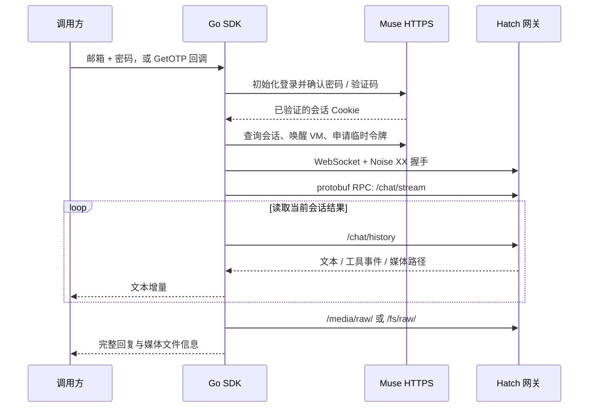

# 协议说明

本文对应仓库中的 Go 实现，字段以模拟测试覆盖的现有协议为准。公共服务地址是互操作所需的端点；所有账号、密码、验证码、Cookie、VM ID 和临时令牌均在运行时由调用方或上游提供。

## 总体流程



## 登录

每次 `login.Login` 使用新的 Cookie jar。`SiteURL` 默认 `https://muse.ai`；HTTP 只允许用于本机测试。跨站跳转受实现内的固定目标限制。请求携带 CSRF、登录流程标识及必要浏览器协议头。

| 阶段 | 请求 / 操作 |
| --- | --- |
| 初始化 | `GET /`，`POST /api/auth/native/restart`，取得 CSRF 与登录状态 |
| 密码准备 | 当 `flow_state=new` 时 `POST /api/auth/native/start`，读取 `password_encryption` |
| 账号初始化 / 发码 | `POST /api/auth/native/send-otp`，JSON 包含 `contact_point` 和可选 `region` |
| 密码确认 | 校验账号状态及密码登录可用性，`POST /api/auth/native/confirm-password` |
| 验证码确认 | 发码成功后调用 `GetOTP(ctx, sentAt)`，`POST /api/auth/native/confirm-otp` |
| 会话收尾 | 按上游响应进行受限的 Meta 会话交接（如果需要），`POST /api/auth/check`，`GET /api/session` |

密码和验证码分支互斥。密码登录虽然也使用 `send-otp` 完成账号初始化，但不请求调用方读取邮件，不提交 OTP，不进行自动回退。验证码方式把回调返回的数字码放入 `otp_code`，同时发送 `return_to: "/"`。注册、年龄确认、授权同意或额外验证要求会返回需要人工处理的错误。

只有已分配 VM 的会话并取得 `hatch_sess`，才返回登录成功。响应中出现可核验的账号身份时会检查是否与请求邮箱匹配；不接受明显不匹配的身份。Cookie、有效期和账号状态通过 `login.Result` 返回，不在库内落盘。

### 密码加密封装

`password_encryption` 提供单字节 `key_id` 和 32 字节公开密钥。每次尝试生成新的 32 字节 AES 密钥，使用 AES-256-GCM；协议要求全零 nonce，因密钥每次重建而不会跨尝试重用同一 key/nonce。Unix 秒时间戳作为附加认证数据。

AES 密钥通过 `golang.org/x/crypto/nacl/box.SealAnonymous` 封装。二进制消息依次包含：版本 `1`、key ID、sealed key 长度（uint16，小端）、sealed key、GCM tag、密文。最终格式：

```text
#PWD_BROWSER:5:<unix_seconds>:<base64_envelope>
```

实现见 [login/password.go](../login/password.go)；测试使用临时密钥解封并核对原始密码，包括空格。Go 字符串可能存在不可控的运行时副本，不把清除局部引用视为完整内存擦除保证。

## HTTPS 会话引导

`muse` 客户端按账号复用引导状态和连接：

1. `GET /api/session?vm_state=live`，读取 `status`、`vm_id`、`vm_state`、`endpoint_url`。
2. VM 不在运行时，`POST /api/hatch/vm/wake`，轮询会话并等待监听端口就绪。
3. `POST /api/hatch/token`，提交 `{vmAddress, vmName}`，取得 `token`。
4. 尝试 `POST /api/hatch/noise-notary-token`，提交 `{vmName}`，读取可选 `notaryToken`。
5. 上游通过 `Set-Cookie` 轮换凭据时，内部副本更新，并通过 `SetHooks` 通知调用方。

这些令牌只在运行时申请。库没有固定账号、设备凭据、VM、Cookie 或认证令牌。

## WebSocket 与 Noise

默认网关为 `wss://hatch.metaaivm.com/v1/noise`。查询参数包括 `vm_id`、`auth_token`、`app_id=hatch-web`、随机 `request_id`，以及可选 `notary_token`。不要记录完整连接 URL。

WebSocket 内执行 `Noise_XX_25519_AESGCM_SHA256`，空 prologue，客户端随机生成静态和临时密钥：

| 握手消息 | Noise pattern | 负载 |
| --- | --- | --- |
| 客户端 → 服务端 | `e` | protobuf `client_nonce`（32 字节随机值） |
| 服务端 → 客户端 | `e, ee, s, es` | 服务端握手负载 |
| 客户端 → 服务端 | `s, se` | 当前标准 VM 流程为空 |

Split 后获得独立发送 / 接收密钥，按各自 nonce 计数器加解密。实现用公开 cacophony 测试向量校验握手密文、hash 和传输消息。检测到需要 RV 密钥认证的机密 VM challenge 时返回不支持；当前实现不验证硬件远程证明，不提供 RV 密钥认证。

## protobuf RPC

每个应用请求由 `ServiceRequest` 指定目标服务，内部用 `ServiceFrame.stream_id` 多路复用。响应沿对应 stream 返回。字段定义见 [hatch/wire.go](../hatch/wire.go)。

| 结构 | 字段编号 |
| --- | --- |
| `NoiseTransportFrame` | `chunk_id=1`，`chunk_index=2`，`total_chunks=3`，`payload=4` |
| `ServiceRequest` | `service=1`，`payload=2` |
| `ServiceResponse` | `payload=1` |
| `ServiceFrame` | `stream_id=1`，`request=2`，`response=3`，`body_chunk=4`，`reset=5` |
| `ApplicationRequest` | `verb=1`，`path=2`，`headers=3`，`body=4`，`end_body=5` |
| `ApplicationResponse` | `status=1`，`headers=2`，`body=3`，`end_body=4` |
| `BodyChunk` | `data=1`，`end_body=2` |
| `Header` | `key=1`，`value=2` |

服务编号为 daemon `0`、sentinel `1`、vault `2`、authd `3`。普通对话调用 daemon，审批调用 sentinel。

`hatch.Conn.Do` 等待完整响应；`OpenContext` 返回流，使用 `NextJSON` 读取 JSON 记录，或 `NextChunk` 读取二进制分块。消费者应关闭 stream。取消、reset、断连均会唤醒等待者；组装与缓冲区有大小上限。

## 对话、审批与媒体

`Chat` 每次创建独立 `session_id`，向 `/chat/stream` 发送 `items`、`message`、`node_id`、`capabilities`、`session_id`、`timezone` 和 `metadata`。图片参考作为 `items` 内联。应用层多轮上下文须由调用方组织到 prompt 中，SDK 不自动续接上一次 `Chat` 的会话。

流的首个响应可提供 `message_id`；后续流记录用于唤醒轮询。回复内容以 `/chat/history?limit=60&session_id=...` 为准，按本轮锚点筛选事件，再根据 assistant / tool 生命周期和稳定窗口判断完成。`onDelta` 返回文本增量，`ChatResult.Text` 返回最终文本。

默认审批策略为 `deny`：只处理当前会话的 `/approvals`，通过 `/approvals/{id}/decide` 拒绝待决权限请求。`ApprovalPolicy="off"` 停止自动处理，`"allow"` 会选择上游提供的允许选项，应由调用方明确决定。

媒体生成沿用同一对话协议，识别事件中的媒体引用，从 `/media/raw/<path>`（备用 `/fs/raw/<path>`）分块下载。协议支持的外部媒体 URL 也可作为下载来源。文件落在 `Config.MediaDir()`，库创建的目录为 `0700`、文件为 `0600`（已有目录权限不会自动修改）。

`GenRequest.N` 限制最多返回多少个文件，不是上游原生生成张数参数；希望生成多张时应在 prompt 表达数量，且检查实际 `len(files)`。尺寸和时长也应按文件实测值判断。下载失败不自动重新生成。

## 错误与接入边界

`muse.KindOf` 区分认证、额度、限流、临时错误、拒绝及输入错误；`RetryAfterOf` 可读取退避建议。`NoRetry` 表示请求可能已送达或已有产物，不应自动重放；`Retryable` 仅提供错误分类，本库不会代为重试整个生成任务。

面向调用方的错误字符串不包含上游响应正文。部分错误通过 `Unwrap` 保留底层诊断信息，不应把完整内部错误对象或账号结构转储到公开日志。低层 `hatch.Response` 本身包含业务正文，是否记录由调用方负责。

公开服务随时可能变化。测试覆盖本地模拟协议与已知向量，不覆盖真实账号资格、出口网络环境、地区限制或当前上游服务可用性。
